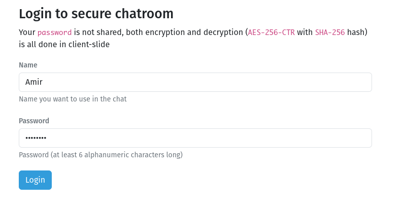
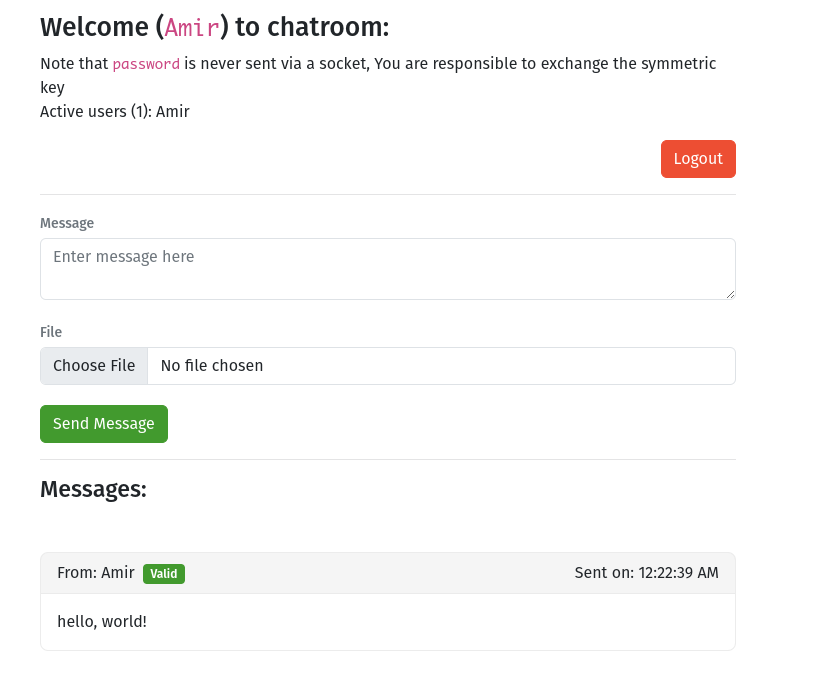

# SymmetricCryptoChatRoom

A shared-password chat room built with Blazor and SignalR. Supports encrypted messages, files, voice/video calls, screen sharing, and opt-in push reminders.

## Usage

Share a channel name and strong passphrase with the people you want to chat with. Exchange the passphrase outside the app.

- Files are limited to **25 MB per message**. Encrypted history is kept for **12 hours** by default.
- **Join call** connects to the channel's voice bridge. **Ring** joins you and invites another user.
- Calls use WebRTC with your self-hosted TURN relay. If connectivity fails, the whole call switches to encrypted HTTPS audio (Stealth mode). You can also force this under **Advanced settings**; video, screen sharing, and transcription are unavailable in that mode.
- Desktop transcription is opt-in and runs locally, downloading a model only when enabled.
- **Enable notifications for this channel** subscribes this device to reminders for the same channel and password. Only **Notify channel** sends reminders; ordinary messages and calls do not.

## Security limitations

Passwords and raw encryption keys are not sent to the server. Encryption happens in the browser:

- Messages, file names, and file contents use PBKDF2-HMAC-SHA256 (210,000 iterations) and AES-256-CTR.
- WebRTC media uses password-based AES-256-CTR in addition to DTLS-SRTP. Stealth audio uses AES-256-GCM with replay protection. Media is never stored in chat history.
- **The CTR formats are not authenticated encryption and reuse a zero IV across fields within a message.** Key-confirmation values also allow offline password guessing. Use a strong passphrase.
- Channel names, display names, timestamps, file sizes/types, and call signaling are not end-to-end encrypted.
- The active password is stored as plaintext in browser `sessionStorage`; saved logins remain in `localStorage` until removed. Avoid shared devices.

Use HTTPS outside localhost. WebRTC calls require browser support for `RTCRtpScriptTransform`; unsupported browsers use encrypted HTTPS audio rather than plaintext. "Stealth" describes the transport, not invisibility or a guaranteed network-filter bypass.

## Hosting

Build the chat image and put it behind an HTTPS reverse proxy:

```powershell
docker build -f Dockerfile.chat -t symmetric-chat .
docker run -d -p 3000:3000 -v chat-data:/app/data --env-file chat.env symmetric-chat
```

Port **3000** serves the app; **/health** is the health endpoint. In Coolify, use a Dockerfile resource with the same port and persistent storage at `/app/data`.

Set these runtime variables in `chat.env` or your hosting platform:

```env
TURN_HOST=turn.example.com
TURN_SECRET=replace-with-a-long-random-secret
TURN_RELAY_ONLY=true
MESSAGE_RETENTION_MINUTES=720
```

Retention must be a positive whole number. Changes require a restart and affect new messages only. Persist `DATABASE_PATH` (default `/app/data/db.litedb`) to retain history and push subscriptions.

### TURN relay

Deploy `Dockerfile.stun-turn` as a separate service with a DNS-only hostname, not an HTTP proxy route:

```env
TURN_EXTERNAL_IP=203.0.113.10
TURN_REALM=turn.example.com
TURN_SECRET=replace-with-the-same-long-random-secret
```

Publish and allow **TCP/UDP 3478** and **UDP 49160-49200**. Relay-only routing is the default; set `TURN_RELAY_ONLY=false` on chat only if direct peer-to-peer connections are acceptable. HTTPS audio does not need TURN or additional ports.

For **TURN over TLS**, set `TURN_TLS_ONLY=true` and `TURN_PORT=443` on chat. On coturn, set `TURN_TLS_ONLY=true`, `TURN_TLS_PORT=443`, `TURN_TLS_CERT_FILE`, and `TURN_TLS_KEY_FILE`; mount a trusted certificate and key read-only. Publish TCP 443 and the UDP relay range, not public 3478. Restart coturn after certificate renewal.

TURN needs raw TCP routing, not an ordinary HTTPS route. If your web proxy already owns port 443, use a separate relay IP/server or a Traefik TCP router for the TURN hostname. With Traefik terminating TLS, keep coturn's `TURN_TLS_ONLY=false` and forward to its private TCP 3478; never expose that hop publicly.

**Test TURN/TLS** checks browser relay allocation without opening the microphone. A successful test does not guarantee two-way media; verify a real call after deployment.

### Push reminders

Generate a VAPID key pair once:

```powershell
dotnet run --project API -- --generate-vapid-keys
```

Configure `Push__PublicKey`, `Push__PrivateKey`, and `Push__Subject` (for example, `mailto:admin@example.com`) on the server. Keep the private key secret and reuse the pair across deployments. Leaving all three empty disables push.

Reminders contain the public channel name, not chat content. Delivery depends on browser/OS permissions; iPhone/iPad users must install the site on their Home Screen. Logout does not disable subscriptions: disable each channel/password subscription before clearing site data or leaving a shared device. Protect database backups, which contain push endpoints.

Deploy server and UI together and refresh existing tabs after updates.

## Tests

Requires .NET 8 and Node.js:

```powershell
npm test
npm run test:call-assets
dotnet run --project Tests\MessageHub.Tests
dotnet run --project Tests\PayloadEncryption.Tests
```

The vendored G.711 codec is checked in for .NET-only builds. After updating its npm dependency, run `npm install`, `npm run check:vendor`, and `npm test`; commit the lockfile and regenerated assets together.

## Screenshots



