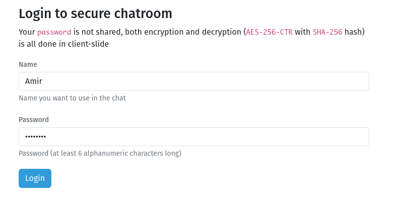
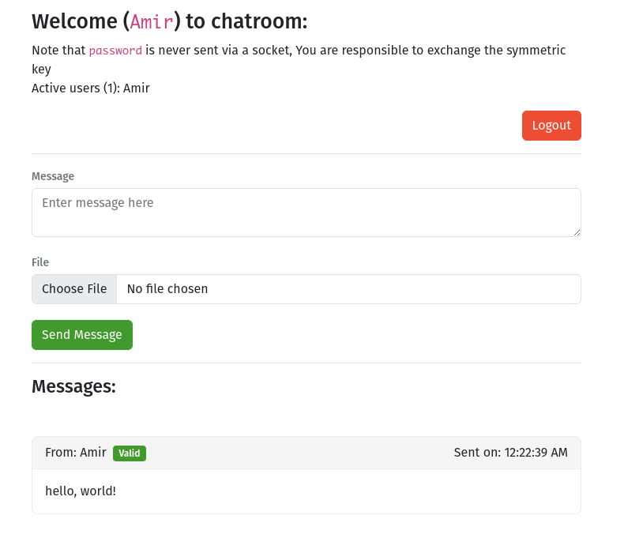

## SymmetricCryptoChatRoom

[![Docker Hub badge][dockerhub-badge]][dockerhub]

Simple secure chat room web (+ file transfer) application using SignalR (dotnet core) and Blazor for front-end and most importantly:
- `PBKDF2-HMAC-SHA256` (210,000 iterations) to derive 256-bit encryption keys locally from the password
- `AES-256-CTR` to encrypt/decrypt the messages

### Note
- `password` is never sent via a socket, You are responsible to exchange the symmetric key
- Both encryption and decryption is all done in client-slide, only ciphertexts are transmitted via Sockets
- File name is transmitted as plaintext but file blob is transmitted as ciphertext
- Combined attachment size per message is limited to `25 MB`
- Attachments use managed gzip compression before encryption when it reduces their size
- Each new message uses a random 16-byte salt for PBKDF2. The salt and an HMAC key confirmation travel with the ciphertext in a versioned token; neither the password nor the derived key is transmitted. A short password is accepted without padding, but remains easier to guess.
- Updated clients can still decrypt cached messages using the legacy SHA-256 key derivation. Older clients cannot decrypt the new PBKDF2 message format and should be refreshed.
- This key-derivation upgrade retains AES-CTR and does not add authenticated encryption or fix its existing zero-IV reuse across fields within a message. Password-derived confirmation values also permit offline password guessing; use a strong passphrase.
- The active session password is stored as plaintext in browser `sessionStorage`. Successful logins are also retained in `localStorage` for optional quick login until individually removed or the site's storage is cleared.
- Used [LiteDB](https://www.litedb.org/) to playback messages from 10 minutes ago to just joined users
- [Fody.PropertyChanged](https://github.com/Fody/PropertyChanged) to detect if any of state's properties changes which triggers re-renders of UI

### Self-hosted voice and video channel

Encryption is mandatory for transmitted message/file contents and call media. Mobile presets, bandwidth adaptation, keyframe recovery, camera changes, and screen sharing never disable it. If encrypted media setup fails, the affected sender is not attached or its track is removed; browsers without encoded-transform support cannot join WebRTC calls. Encryption failures never fall back to plaintext or transport-only media.

#### Audio over HTTPS (Stealth mode)

**Automatic is the default:** join normally to try encrypted WebRTC audio/video. If a peer connection fails, cannot connect within approximately 20 seconds (checked every five seconds), or connects but receives no audio RTP packets within that time, clients negotiate a switch of the **whole call** to encrypted HTTPS audio. Silence is not the trigger; received packet counts are used. A password mismatch is reported as unreadable media, not a reason to change transport.

To skip WebRTC, enable **Advanced settings → Force Audio over HTTPS (Stealth mode)** before joining. **Other Automatic participants switch with you; they do not need to enable the setting.** Browsers without encrypted WebRTC support also request HTTPS immediately. Everyone remains in one call, but the entire call becomes audio-only: cameras, screen sharing and transcription stop. Mute and call duration are preserved. The call stays on HTTPS until everyone leaves, avoiding repeated transport changes; the next new call starts in Automatic again. Both people must join; ringing alone does not join the caller.

This mode carries end-to-end encrypted audio through the existing SignalR chat connection: HTTPS/WebSockets where available, or SignalR's negotiated HTTP fallback. **No new ports, TURN settings, certificates, or Coolify proxy changes are needed.** Deploy the updated server and UI together, then refresh both clients. Keep the existing HTTPS chat endpoint working; TURN is not used by this mode. **Test TURN/TLS** continues to test TURN, not Stealth audio.

Stealth mode prefers **browser-native WebCodecs Opus**, mono 48 kHz, targeting 24 kbps with 40 ms packets. Before joining, each browser checks both `AudioEncoder.isConfigSupported` and `AudioDecoder.isConfigSupported`, including the requested Opus frame duration, then performs a small synthetic encode/decode probe without accessing the microphone. The runtime result is cached for the page: some browsers advertise a configuration that their decoder cannot actually use. Opus is selected only if every participant supports it. Otherwise, the whole call explicitly uses compatibility G.711 mu-law at 8 kHz (telephone quality, 64 kbps before overhead, roughly 100 kbps with encryption/JSON). The active codec is shown beside the call status, with an explanation when compatibility audio is needed. A later incompatible join can change the common codec; it is not upgraded again mid-call.

Camera, screen sharing, transcription, and WebRTC quality presets do not apply in Stealth mode. It requires a secure browser context, WebCrypto and AudioWorklet, but not WebRTC encoded transforms. Microphone capture starts only when another participant joins and stops when the last leaves. Native codec errors fail closed with an explicit message rather than silently sending another format or plaintext.

Each sender derives a separate AES-256-GCM key using HKDF-SHA-256, the existing password-derived voice key, a random stream ID, and a Stealth-specific domain separator. Frames authenticate their codec/version headers and monotonic counters; wrong-password, modified and replayed frames are not played. Native Opus decoder metadata comes from the browser encoder and travels inside the encrypted payload. Shared media revisions discard in-flight audio from an obsolete transport or codec before playback. The server coordinates transport and codec capabilities but does not receive the password or decryption key. Audio uses dedicated, size/rate-bounded media relay calls and is **never stored in chat history**. Receive warnings identify unreadable encrypted audio. The call-health icon reports recent authenticated reception and queue congestion; green does not prove that the other person can hear you. Debug details show Stealth audio byte counts rather than ICE statistics.

“Stealth” means ordinary HTTPS-based transport, **not invisibility or a guaranteed filtering bypass**. A network can still block the domain, WebSockets, HTTPS traffic patterns, or the connection itself. TCP retransmissions can also cause more delay and dropouts than WebRTC. Use headphones when testing two devices near each other.

The chat page starts with **Advanced settings** and **Debug mode** off. Everyday call controls, including **Keep screen on** during calls on supported mobile browsers, stay visible; **Advanced settings** reveals audio/camera quality, the transcription model, and the transcription download warning. **Debug mode** reveals server-side STUN/TURN health checks, ICE diagnostics, message state, and invalid-message controls. These switches are independent and apply only to the current chat page. Hiding advanced settings preserves selected values and does not stop active call features; disabling debug mode hides diagnostic output and invalid messages and stops ICE diagnostic polling.

**Test TURN/TLS** stays visible without advanced or debug mode, before or during a call. It obtains short-lived credentials and asks this browser to allocate a TURN relay using the same ICE endpoints as calls, always forcing relay-only routing for the test. It never opens the microphone/camera, joins a call, or changes an existing call's connections. A green **Last test: TURN TLS verified** means authenticated allocation succeeded using only the configured `turns:` endpoint; red **TURN TLS failed** means it did not. Legacy configurations show **TURN reachable (no TLS)** in amber, never TLS success. Failures include available ICE error details; a stalled test times out after 15 seconds. Leaving the chat cancels the test and closes its temporary connection. Results describe the most recent allocation test, not continuous connectivity or two-way audio/video delivery; retest after changing networks. The separate debug-only **Check server relay** reports **Server TURN TLS verified** when the API server validates the TLS certificate and STUN response, and must not be confused with browser reachability.

While joined to the voice/video bridge, a small signal icon beside the heading shows measured WebRTC call health, not just whether SignalR is connected. Every five seconds it checks packet loss, round-trip latency, jitter, and available outgoing bandwidth relative to the selected audio/video presets, including screen sharing. Three green bars indicate healthy measurements; two amber bars indicate degradation (over 2% loss, 150 ms round-trip latency, 30 ms jitter, insufficient bandwidth headroom, or browser-reported bandwidth limitation); one red bar indicates poor health (over 5% loss, 300 ms latency, 60 ms jitter, less than half the required outgoing bitrate, or a disconnected/failed peer). The worst participant connection determines the icon. Gray bars mean waiting for a participant, connecting, or measurements unavailable, never an assumed healthy connection. A tooltip and screen-reader status provide measurement details. This indicator is independent of advanced/debug settings.

The chat application and coturn are deployed as separate Dockerfile-based services. Coturn can be built using this repository's `Dockerfile.stun-turn`; existing deployments may instead use the sibling `stun-turn-setup` repository. No public STUN/TURN service is configured. Encoded audio and video frames are encrypted with AES-256-CTR using a PBKDF2 key derived from the channel name and shared chat password. Each encrypted frame carries its header length and an eight-byte counter so decryption remains consistent across browsers. WebRTC DTLS-SRTP authenticates and encrypts the media transport as a second protection layer.

Password-encrypted calls require a browser with `RTCRtpScriptTransform` support. Offers and answers include an HMAC confirmation of the derived media key without transmitting the password or key. Participants using different passwords can join the same channel and establish calls, but incompatible peers show **Unreadable media - different password** instead of playing noise or displaying corrupted video. Incoming frames are discarded before decoding until the peer's key confirmation matches; incompatible audio is also excluded from transcription. Missing confirmations are treated as unreadable rather than blocking the call. Matching-password participants in the same call can still hear and see one another normally. The connection fails closed when encoded transforms are unavailable; it never sends audio or video protected only by WebRTC transport encryption. Joining the bridge alone does not open the microphone; audio capture starts when another voice participant connects and stops again when the last peer leaves. Separate sessions can use the same display name and call each other. Matching names in a channel (case-insensitive) receive distinct `(session N)` labels in presence, call controls, video captions, and newly sent messages. These labels identify browser sessions, not hardware; reconnecting the same client instance still replaces its stale connection. Calling the current connection remains blocked. When calling between your own devices, mute one microphone or use headphones to avoid feedback. Calls start as audio-only. Use **Start video** during a call to grant camera access and share video, and **Stop video** to stop the camera and remove its WebRTC sender. Receive-only transceivers also initialize their sender encryption before answering, so enabling the second camera can safely reuse them. **Share screen** uses the browser's screen picker and replaces the encrypted camera track without creating another participant tile. Stopping the share restores the camera when it was active beforehand, or returns the call to audio-only otherwise.

**Ring** is an invitation to join the channel's voice bridge, not a requirement to join it yourself. Any online user in the same channel can ring another, whether neither, one, or both have joined the bridge. Sending a ring does not join the sender or request microphone access; the sender can use **Join call** separately. Answering an incoming invitation stops its ringtone and acknowledges acceptance before media initialization or microphone permission completes, so the caller stops ringing instead of timing out during setup. Both **Accept** and **Join call** accept a pending incoming invitation and join the recipient if needed. Answer/decline clicks stop the actual playing audio immediately in the browser; playback ownership and cancellation guards prevent stale elements or delayed playback promises from continuing the ring. **Ring** remains available beside **In call**, so already-connected participants can be alerted without leaving or rejoining the call. Voice key derivation uses C#/.NET `Rfc2898DeriveBytes.Pbkdf2` with the same PBKDF2 parameters and channel salt as before. This synchronous derivation can briefly block the browser during call setup.

Live transcription is opt-in. Until **Start transcription** is selected, the application does not download or evaluate the transcription audio-processing module, create a transcription worker or audio-processing graph, import Transformers.js, or request model files. The default Auto option chooses quantized multilingual Whisper Tiny, Base, or Small from browser-reported memory, logical processor count, and mobile input characteristics. Manual multilingual and English-only Tiny, Base, and Small options are also available; larger models improve accuracy but increase download size, memory use, and processing latency. Enabling transcription lazily downloads only the selected model, mixes local and remote call audio in the browser, and transcribes short windows on-device. Call audio is not uploaded for inference. The browser can cache downloaded model files for later sessions; stopping transcription terminates the worker and audio graph, and leaving the bridge clears the displayed transcript.

Live transcription is desktop-only. On phones and tablets, including iPads using a desktop user agent, **Start transcription**, its download warning, and the model selector are hidden regardless of connection speed or Network Information API support. Mobile startup attempts are rejected before transcription modules, workers, or models are loaded. Desktop transcription remains opt-in and an already-running session retains **Stop transcription**.

Transcription, bandwidth adaptation, and encrypted video recovery regression tests use Node.js's built-in test runner (no npm dependencies). From the repository root, run:

```powershell
node --experimental-vm-modules --test UI\Tests\voice-chat.test.cjs UI\Tests\voice-crypto-worker.test.cjs UI\Tests\password-key-derivation.test.cjs UI\Tests\ringtone.test.cjs
dotnet run --project Tests\MessageHub.Tests
dotnet run --project Tests\PayloadEncryption.Tests
```

Message/file password derivation uses the browser's asynchronous Web Crypto API to avoid blocking the UI. The password-derivation Node tests verify Web Crypto PBKDF2 against the platform implementation, short and Unicode passwords without padding, salt validation, and explicit failure without weaker fallbacks. The payload encryption regression executable verifies C# voice key derivation against independent PBKDF2 vectors and uses a platform-PBKDF2 interop test double to verify random per-message salts, password/key exclusion from serialized payloads, wrong-password behavior, message and attachment round-trips, legacy cached-message compatibility, and rejection of malformed or unsupported encryption tokens.

For real-browser coverage, serve the repository root locally (`python -m http.server 8765 --bind 127.0.0.1`) and open `http://127.0.0.1:8765/UI/Tests/voice-chat.browser.html` in a browser supporting encoded transforms. It uses synthetic cameras and audio, without requesting device access, and checks continuous two-way decoding and rendered pixels, recipient resolution changes (144p, 720p, and 240p), camera restarts, simultaneous camera activation, encrypted audio and mute/unmute, screen sharing with and without a camera, camera restoration at the selected quality, and leaving/rejoining with the opposite offerer. It also checks that different-password peers establish connections and exchange encrypted packets while showing unreadable-media indicators, muting audio, hiding video, and discarding incompatible video before decoding. The local-only test disables network adaptation to measure the selected resolutions deterministically; Node tests cover per-recipient bandwidth constraints and ringtone cancellation, delayed playback, replaced audio elements, and component cleanup. The hub regression executable checks matching-name presence, ring/accept/decline/cancel behavior (including already-connected participants), signaling, preservation of encrypted message/attachment data, voice rejoin, stale reconnect cleanup, and channel isolation.

On phones and tablets, audio and camera quality start at the **Very low** presets: 12 kbps audio with a preferred 16 kHz capture rate, and 144p camera video at up to 8 fps and 100 kbps. This includes Android, iPhone, and iPad browsers (including iPads reporting a desktop user agent). These defaults do not automatically increase beyond the selected preset's bandwidth ceiling; users can still choose Low, Medium, High, or Auto, and their selection is retained when rejoining or reconnecting within the same chat page. Device detection loads only a small helper, not the voice or transcription modules. Desktop defaults remain Auto.

On desktop, voice quality defaults to Auto at the 32 kbps Medium profile. It promotes to the 64 kbps High profile after sustained good packet loss, round-trip time, and outgoing-bandwidth measurements, then falls back to Medium when conditions degrade. Manual Low, Medium, and High modes remain available.

Desktop camera quality defaults to Auto. It starts at Medium (480p, 24 fps, up to 700 kbps), promotes to High (720p, 30 fps, up to 1.5 Mbps) when network measurements remain strong, and steps down to Low (240p, 15 fps, up to 250 kbps) as conditions degrade. Very low, Low, Medium, and High profiles can be selected manually before or during a call.

Camera quality changes update both capture constraints and every recipient's encoder resolution, bitrate, and frame-rate limits. Encoder scaling accounts for the actual capture dimensions, including cameras that retain a larger capture size. Resolution changes do not rely on the browser's separate balanced spatial adaptation; per-recipient network adaptation below still applies. Capture constraint failures are reported instead of claiming the new quality was applied. Debug diagnostics include encoded and decoded frame dimensions and frame rates.

When renegotiation delivers a replacement video track, the participant tile switches to that track rather than accumulating inactive video tracks. Mute/end events from a superseded track cannot hide the current video.

Regardless of Auto or manual camera quality, each recipient's reported outgoing bandwidth, round-trip time, and video packet loss can temporarily lower that recipient's video bitrate, frame rate, and encoded resolution below the preset. Bandwidth estimates reserve room for audio and transport overhead; constrained video can drop to 50 kbps and 5 fps. Recovery is gradual and never exceeds the selected preset. Screen sharing also honors the per-recipient bitrate/frame-rate limits while preserving text resolution. Auto only promotes camera quality when an outgoing bandwidth estimate supports it. These are best-effort limits, not a guarantee that video is usable on every connection.

The encrypted video receiver detects gaps in frame counters and requests a fresh keyframe, throttled to once per second. It holds dependent delta frames until a keyframe arrives rather than feeding broken references to the decoder. A poor connection may therefore briefly freeze the last good image instead of displaying corrupted blocks. The encrypted frame format and audio handling remain unchanged.

Microphone audio uses real-time echo cancellation, noise suppression, and automatic gain control. Browsers that expose native voice isolation use it automatically; other browsers retain the standard WebRTC noise suppression fallback. The ICE debug view reports which processing features are supported and active.

While voice is active, supported mobile browsers keep the screen awake and use their communication audio-session mode. Manually locking the device can still suspend a browser call when the mobile operating system does not allow background microphone or WebRTC activity.

Supported iOS browsers show an in-call **Audio output** selector with Auto, Earpiece, and Speaker modes. Auto delegates routing to the phone's call audio session so the operating system can apply its proximity behavior; browsers do not expose the raw proximity sensor to the application. Earpiece and Speaker request a fixed handset route. Browsers implementing the Audio Output Devices API instead show **Choose output** for selecting a speaker, wired headset, or Bluetooth device through the system picker. Browsers without either API continue using the operating system's default route.

`TURN_RELAY_ONLY` defaults to `true`. In this mode WebRTC uses `iceTransportPolicy: "relay"`, so voice fails instead of connecting directly when the configured coturn service is unavailable. Set it to `false` only when direct peer-to-peer paths through the configured STUN server are acceptable.

`TURN_TLS_ONLY` defaults to `false`, preserving the existing STUN and TURN UDP/TCP configuration. Set it to `true` on the chat service to use only `turns:TURN_HOST:TURN_PORT?transport=tcp`. TLS-only mode always enforces relay-only ICE, even if `TURN_RELAY_ONLY=false`, and never falls back to direct, STUN, or unencrypted TURN connections. `TURN_HOST` is required in this mode and must match the relay's trusted certificate. `TURN_PORT` is the public client-facing port: it defaults to `443` in TLS-only mode and `3478` otherwise. Invalid TLS-mode or port settings fail explicitly.

Set `TURN_EXTERNAL_IP` on the coturn service to its Docker host's public IPv4 address. Also publish and allow TCP/UDP 3478 and UDP 49160-49200 through the host firewall and network security rules. Set `TURN_HOST` on the chat service to the public DNS name clients should use.

Set `TURN_SECRET` explicitly. The API uses it to issue short-lived credentials, and the coturn service uses the same value to validate them.

Password derivation through Web Crypto and microphone/camera access require a secure browser context. Use a trusted HTTPS certificate in production, either at a reverse proxy on the same host or by configuring ASP.NET Core HTTPS and mounting the certificate into the container. Plain HTTP works only on `localhost` or a loopback address for these browser features.

#### Coolify

Create a Dockerfile resource for this repository and route `chat.coolify.hesamian.com` to container port `3000`. Configure persistent storage at `/app/data` for LiteDB playback data.

The chat image checks `http://127.0.0.1:3000/health` every 30 seconds. Coolify should report the container as healthy after its startup grace period.

Create a second Dockerfile resource from the `stun-turn-setup` repository. Do not add `turn.coolify.hesamian.com` to Coolify's Domains panel because STUN/TURN is not HTTP. Publish TCP/UDP 3478 and UDP 49160-49200 directly from the coturn container to the host.

Set these environment variables on the chat service:

```env
TURN_HOST=turn.coolify.hesamian.com
TURN_SECRET=replace-with-a-long-random-secret
TURN_RELAY_ONLY=true
```

Set these environment variables on the coturn service:

```env
TURN_EXTERNAL_IP=203.0.113.10
TURN_REALM=chat.coolify.hesamian.com
TURN_SECRET=replace-with-the-same-long-random-secret
```

Create a DNS-only `A` record at your DNS provider for `turn.coolify.hesamian.com`, pointing to the value of `TURN_EXTERNAL_IP`. When using Cloudflare, set it to DNS only. Allow TCP/UDP 3478 and UDP 49160-49200 in the server provider's firewall.

To verify relay routing in Chromium or Edge, open `chrome://webrtc-internals` or `edge://webrtc-internals` during a call and inspect the selected ICE candidate pair. The local candidate type must be `relay`, and its relay protocol/address must correspond to the configured `TURN_HOST`. With `TURN_RELAY_ONLY=true`, a non-relay candidate cannot be selected.

#### Restricted networks: TURN over TLS on TCP 443

Successful messaging or ringing only proves SignalR connectivity, not WebRTC media connectivity. Networks that block UDP or recognize plain TURN may still allow TURN over TLS on TCP 443. Media remains password-encrypted; TLS additionally protects the browser-to-relay TURN connection. This is not HTTPS camouflage or a guaranteed DPI bypass: hostname/IP blocking, TLS fingerprinting, and traffic analysis can still prevent calls.

This repository's `Dockerfile.stun-turn` supports the TLS deployment below. If using the sibling `stun-turn-setup` repository instead, update its coturn configuration equivalently; changes here do not change that deployment automatically.

1. Use a dedicated DNS-only hostname, such as `turn.example.com`, pointing to the relay's public IP. Obtain a publicly trusted certificate for it. Mount the full certificate chain and private key read-only into the coturn container; never bake them or `TURN_SECRET` into the image or commit them.
2. Ensure TCP 443 is available on that public IP. If the chat HTTPS proxy already occupies it, use a separate relay server/public IP, or a deliberately configured layer-4 routing solution. An ordinary HTTP reverse proxy, Coolify domain route, or Cloudflare HTTP proxy does not carry TURN.
3. Build the relay using `Dockerfile.stun-turn` from this repository. Configure the chat service:

   ```env
   TURN_HOST=turn.example.com
   TURN_SECRET=replace-with-a-long-random-secret
   TURN_TLS_ONLY=true
   TURN_PORT=443
   TURN_RELAY_ONLY=true
   ```

   Configure the coturn service:

   ```env
   TURN_EXTERNAL_IP=203.0.113.10
   TURN_REALM=turn.example.com
   TURN_SECRET=replace-with-the-same-long-random-secret
   TURN_TLS_ONLY=true
   TURN_TLS_PORT=443
   TURN_TLS_CERT_FILE=/etc/coturn/certs/fullchain.pem
   TURN_TLS_KEY_FILE=/etc/coturn/certs/privkey.pem
   TURN_MIN_PORT=49160
   TURN_MAX_PORT=49200
   ```

   Mount your certificate and key at the configured paths. If mounting an ACME certificate directory with symlinks, also mount the symlink targets. The container user must be able to read both files. Startup fails if either is missing or unreadable. Renew the certificate automatically and restart/redeploy coturn after renewal so it loads the new certificate.
4. Publish **TCP 443** and **UDP 49160-49200** directly to the coturn host, and allow them through the host/provider firewall. The relay UDP range is still needed on the server even though restricted clients reach it using TLS/TCP. Set `TURN_EXTERNAL_IP` to the correct public address; NAT deployments must also map the relay port range correctly. `EXPOSE` alone does not publish any ports.
5. Do **not** publish TCP/UDP 3478 for a TLS-only deployment. The image disables the plain TCP listener but retains internal UDP 3478 for its container health check. `TURN_LISTENING_PORT` changes this internal port; `TURN_TLS_PORT` changes the container TLS listener. If host and container TLS ports differ, the chat service's `TURN_PORT` must name the public port.
6. Redeploy both services and refresh both browsers. In **Debug mode**, the STUN/TURN health button now validates the TLS certificate and a STUN binding response over TLS when TLS-only mode is configured. It runs from the API server: a green result is not proof that the restricted client can connect or that authenticated media allocation succeeds. The container's own health check only checks its internal UDP STUN listener.
7. Make a call on the affected network. In ICE diagnostics/browser WebRTC internals, verify a selected relay candidate, the TLS relay transport (where exposed by the browser), the configured public endpoint, and increasing media byte counters in both directions. If ICE connects but media stays unreadable, check both peers' passwords, microphone permissions, and encoded-transform browser support. Compare with another network or a trusted censorship-resistant tunnel if TLS traffic is still blocked.

TLS-only configuration does not disable mandatory media encryption. TCP relay can add latency and head-of-line blocking on lossy networks; lower audio/video quality if necessary.

##### Coolify port and certificate checklist

The following checklist is for **direct TLS termination in coturn**. If Traefik already owns port 443 on the same public IP and you want it to manage the certificate, use **Traefik TLS termination** below instead; do not combine the two configurations.

Keep the chat resource's HTTPS domain and container port `3000` unchanged. On the coturn resource, use this repository's `Dockerfile.stun-turn`, leave **Domains** empty, and configure raw host port mappings rather than an HTTP route:

| Public host port | Coturn container port | Protocol |
| --- | --- | --- |
| 443 | 443 | TCP |
| 49160-49200 | 49160-49200 | UDP |

For a Coolify Docker Compose resource, the corresponding service port entries are:

```yaml
ports:
  - "443:443/tcp"
  - "49160-49200:49160-49200/udp"
```

Confirm that UDP is explicitly selected; a TCP-only relay-range mapping is insufficient. Also allow these ports in the provider firewall. Do not expose the internal STUN health-check port publicly.

Coolify's HTTPS proxy normally already binds TCP 443. Another DNS hostname pointing to the same IP does not free that port. Prefer a dedicated public IP/server for coturn on 443; do not stop the chat proxy to free it. As an alternative, publish host TCP `5349` to coturn container TCP `443` and set `TURN_PORT=5349` on the chat resource, leaving `TURN_TLS_PORT=443` on coturn. This avoids the port collision but the restricted network may block 5349 even when it allows 443.

Use **Persistent Storage** to mount the certificate and key into the coturn resource at their configured paths, or declare read-only bind mounts in Compose. Coolify's automatic HTTPS certificate management for chat domains does not automatically install a usable certificate into coturn. Arrange trusted certificate issuance, renewal, read permissions, and a coturn restart after renewal separately.

Apply the environment variables above at runtime to the correct resource, deploy both resources, and refresh all existing browser tabs so they load the TLS-capable client. If coturn currently builds from the sibling repository, changing only the chat deployment is insufficient. Finish by testing an actual two-way call from the restricted network.

##### Coolify Traefik TLS termination: no certificate files in coturn

Traefik can terminate TLS for a dedicated TURN hostname using a **TCP router** on its existing HTTPS entry point. It then forwards decrypted TURN bytes, not HTTP, to coturn over a private Docker network:

```text
Browser -- TURN/TLS :443 --> Traefik -- TURN/TCP :3478 --> coturn
```

This shares public TCP 443 with the chat HTTPS site without publishing another host TCP listener. Traefik obtains and renews the TURN hostname's certificate using its configured ACME resolver. Mandatory password-based media encryption and DTLS-SRTP remain enabled; the TURN connection between Traefik and coturn is not TLS-protected, so keep that hop on a trusted private Docker network.

1. Create a DNS-only `A` record for a separate TURN hostname pointing to the Coolify server. Do not create a normal HTTP domain route for that hostname. Remove an incorrect `AAAA` record if the server cannot accept this traffic over IPv6.
2. Keep `TURN_TLS_ONLY=true`, `TURN_PORT=443`, `TURN_RELAY_ONLY=true`, and the TURN hostname on the **chat** resource.
3. Set **`TURN_TLS_ONLY=false` on the coturn resource**. Keep `TURN_LISTENING_PORT=3478`, the correct public `TURN_EXTERNAL_IP`, and the same `TURN_SECRET` as chat. In this configuration `start-turn.sh` deliberately does not require a certificate or key: TLS is handled by Traefik, not coturn.
4. Ensure Traefik and coturn share a Docker network. Add these custom labels to the coturn resource, replacing the hostname and, if necessary, Coolify's usual `https` entry point and `letsencrypt` resolver names:

   ```text
   traefik.enable=true
   traefik.tcp.routers.turn-relay.rule=HostSNI(`turn.example.com`)
   traefik.tcp.routers.turn-relay.entrypoints=https
   traefik.tcp.routers.turn-relay.service=turn-relay
   traefik.tcp.routers.turn-relay.tls=true
   traefik.tcp.routers.turn-relay.tls.passthrough=false
   traefik.tcp.routers.turn-relay.tls.certresolver=letsencrypt
   traefik.tcp.routers.turn-relay.tls.options=turn-relay@file
   traefik.tcp.services.turn-relay.loadbalancer.server.port=3478
   ```

   If coturn has multiple Docker networks, also set `traefik.docker.network` to the actual network shared with Traefik. Keep unrelated Coolify management labels. Never use a wildcard HostSNI rule for this router: that would also capture other sites' TLS traffic. Do not enable TLS passthrough, which would require coturn's own certificate again.
5. In the server's Traefik **Dynamic Configurations**, add the following TLS option. It is specific to this TURN router and does not change the chat site's TLS settings:

   ```yaml
   tls:
     options:
       turn-relay:
         minVersion: VersionTLS12
         alpnProtocols:
           - stun.turn
           - stun.nat-discovery
   ```

   These ALPN identifiers allow clients that advertise STUN/TURN protocols rather than HTTP. SNI-based sharing requires clients to send the TURN hostname in their TLS handshake; verify the actual browsers used.
6. Publish only **UDP 49160-49200** from coturn to the same host port range, and allow it in the host/provider firewall. Do not publish coturn TCP 443 or TCP/UDP 3478. Traefik already publishes public TCP 443 and reaches coturn's 3478 internally. Leave the chat container port and its existing HTTPS route unchanged.
7. Redeploy coturn and chat, check Traefik's logs for successful certificate issuance, then refresh both browsers. The chat's TLS health check targets public Traefik port 443 and validates the certificate and backend STUN response. Test an actual two-way call on the restricted network; an HTTP request to the TURN hostname is not a valid health check.

Coolify's standard resolver uses an HTTP challenge: public DNS must point to this server and port 80 must remain reachable for issuance/renewal. If your proxy uses a different ACME challenge, follow its requirements instead. A dedicated TURN hostname is essential: routing all traffic for that hostname to coturn means it cannot also serve the chat website.

See [Coolify's Traefik overview](https://coolify.io/docs/core/networking/proxy/traefik/overview) and [Traefik TCP TLS configuration](https://doc.traefik.io/traefik/reference/routing-configuration/tcp/tls/).

### Screenshots


--


[dockerhub-badge]: https://img.shields.io/docker/pulls/amir734jj/symmetric-crypto-chatroom
[dockerhub]: https://hub.docker.com/repository/docker/amir734jj/symmetric-crypto-chatroom
